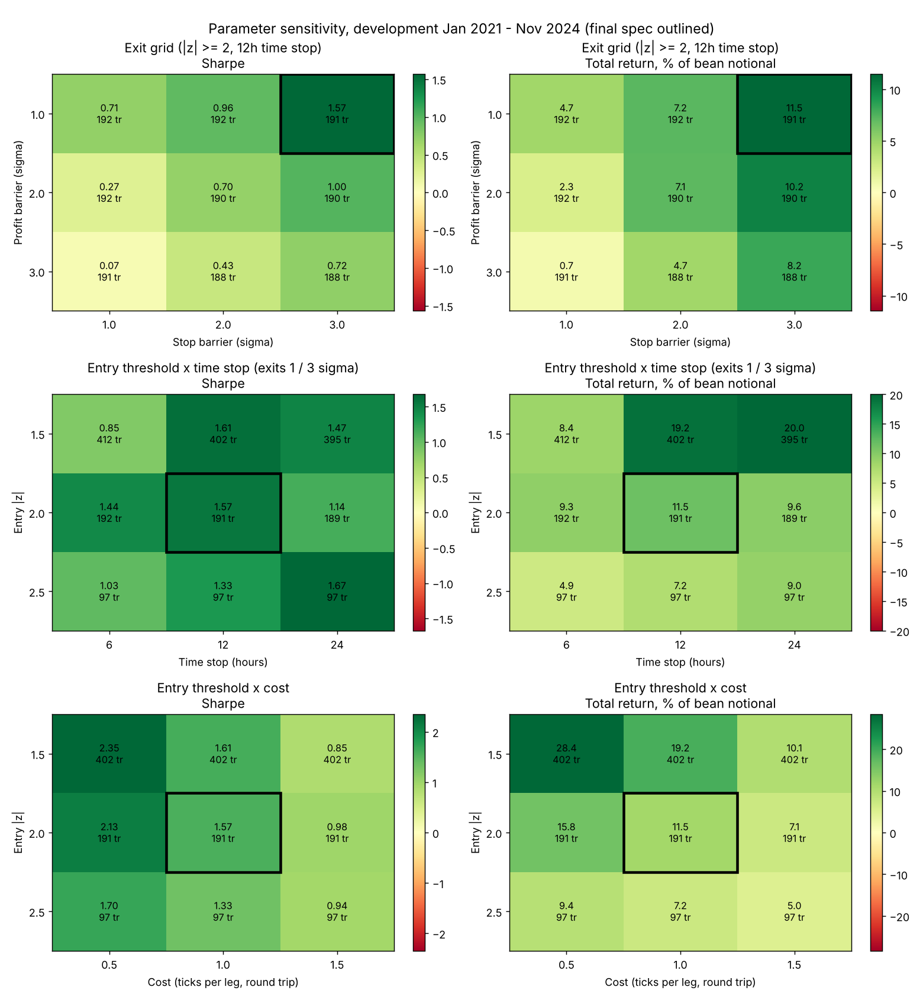

# Overnight crush-residual reversion (ZS vs ZM / ZL)

Research on how soybeans trade against meal and oil intraday, and whether overnight
dislocations in that relationship are tradeable.

## Pipeline

| File | What it does |
|---|---|
| `data_ingest.py` | 1-minute ZS/ZM/ZL data -> sessions, switch-free returns, contract-switch detection, back-adjusted prices, session-aligned 5-minute bars |
| `kalman_filter.py` | Kalman filter for `log ZS = alpha + b_meal log ZM + b_oil log ZL`; hedge frozen at the previous session close; residual |
| `features.py` | Residual z-score (previous 20 days, same session type) and the evening-session signal |
| `strategy.py` | Final strategy: next-open entry, triple-barrier exits, costs, performance, equity/drawdown chart |
| `config.yaml` | Every param, the split dates, the validation grid and the gates |
| `validate.py` | Walk-forward validation over the grid on development only; results, plots and gates saved to `runs/` |
| `holdout.py` | One-time holdout, locked until the latest validation passes every gate on the current config |
| `meta_model_reference.py` | Reference only: feature engineering, IC table, meta-model walk-forward (did not survive the holdout) |
| `kalman_calibration.py` | Research: MLE of the Kalman noise (4 specs), P&L-free scoring |
| `kalman_reversion.py` | Research: does each spec's residual revert, by session and horizon, vs cost |
| `kalman_speed_sweep.py` | Research: adaptation speed x hedge mode (session-frozen / live) |
| `kalman_zscore.py` | Research: six ways to scale the residual into z |
| `exit_study.py` | Research: time stop x profit x stop for four filter/z pipelines |
| `config_original.yaml` | The pre-recalibration pipeline, to re-run for comparison |

Run: put the raw 1-minute parquet at `data/raw/latest_df_backup.parquet`, then `python -m strategies.crush_strategy.validate`.

## Current baseline (recalibrated Oct 2026, branch `crush/kalman-calibration`)

- **Signal:** evening session (19:00-07:45 CT), first 5-minute bar with |z| >= 1.5 on the Kalman residual
  (hand-set filter, roll20 z); re-arms below 0.5
- **Entry:** next bar's open; hedge frozen at the signal bar; **no new entries in the last 3 h of the session**
  (after ~04:45 CT in the evening session)
- **Exits (first touched):** profit 1 sigma, disaster stop 4 sigma, or the **close of the entry session**
  (12 h clock cap). Trades never carry into the day session or the next evening.
- **Costs:** 1 tick per leg round trip (0.58 c/bu); every signal taken, one trade at a time

| Version | Trades | Net / trade 2021-22 / 2023-24 | Return | Max DD | Sharpe | Walk-forward OOS Sharpe | Min fold Sharpe |
|---|---|---|---|---|---|---|---|
| Session exit | 412 | 0.86 c / 0.10 c | +15.1% | -1.0% | 2.25 | 1.10 | 0.23 |
| **+ 3 h entry cutoff (current)** | 292 | 1.36 c / 0.29 c | +18.3% | -1.1% | 2.90 | 2.53 | 1.11 |

Both pass every gate (`runs/20261029-085052_validation`, `runs/20261029-085931_validation`). The cutoff came
from the trade-level feature screen (`feature_screen.py`): time left in the session was the strongest feature in
2021-22 (IC 0.34) and held in 2023-24 (IC 0.32); the 3 h value was picked on 2021-22 (plateau 3-8 h).
Volatility regime (sigma in cents) did NOT confirm: strong in 2021-22, flat in 2023-24. The Dec 2024 - Dec 2025 holdout was already seen
before this recalibration, so it is **not** a clean test of this version; a clean test needs data after Dec 2025.

### What the recalibration found (development only; 2021-22 to choose, 2023 - Nov 2024 to confirm)

1. **Kalman noise** (`kalman_calibration.py`): MLE says the hand-set R was ~370x too large and wants per-session
   noise and ~44x extra drift at session opens. But only the drift-to-noise ratio moves the hedge, and the hand-set
   ratio already sits in the range where the residual reverts best (`kalman_speed_sweep.py`). With fixed exits the
   MLE filter lost to the hand-set one in every pipeline, so hand_set stays; `mle` is kept for other bar sizes.
2. **Day session** (`kalman_reversion.py`, `day_session_study.py`): real but weak bar-level reversion (IC ~0.03
   vs ~0.10 evening). At trade level it is **not tradeable**: 180 variants (session / live hedge x threshold x
   exits x cutoff), median net per trade negative in both windows, only 2% of the grid positive in both, and the
   best 2021-22 variant (51 trades) loses in 2023-24. Adding it to the evening strategy cut the 2023-24 Sharpe
   from 1.31 to 0.44. The bar-level lead came from overlapping bars early in the session; closed.
3. **z-score** (`kalman_zscore.py`): scaling barely changes ranking. roll20's tails are too fat (|z| >= 2 on ~7% of
   bars); pct20 fixes calibration but did not beat roll20 at trade level.
4. **Exits** (`exit_study.py`): ~60% of the old trades carried past the session close and lost money on average;
   the session exit doubles Sharpe and halves drawdown mostly by removing variance, not by adding edge per trade.
   Stops hurt (they exit at the largest dislocation); a 0.5-1 sigma profit target helps.
5. **Bar size** (`timeframe_study.py`, 1 minute excluded for execution / capacity): 5 min is best on every
   validation metric (Sharpe 2.90, walk-forward OOS 2.53, min fold 1.11) vs 10 min (2.42 / 2.12 / 0.25),
   15 min (2.30 / 0.89 / 0.15) and 30 min (2.03 / 1.01 / -0.38). Per-trade edge in 2023-24 falls with bar size
   (0.29 -> 0.16 c): later entries. The hand-set speed holds at every bar size (0.3x / 3x not consistently better).
6. **Capacity** (5-min trades): meal is the bottleneck. 30-minute front-month volume after entry is ~235 ZM
   contracts (median); 10 bean contracts (~10 ZM, ~7 ZL) is ~4% of it (p90 10%); 25 is ~11% (p90 26%).
   About 10 lots per trade at 5-minute execution; more needs orders worked over a longer window.
7. **Open problem:** in 2023-24 the edge per trade is ~0.1 c +/- 0.13 after costs. The Sharpe there comes from low
   variance; the edge scales with volatility. Next step: features / regime filter.

Many variants were tried (4 Kalman specs, 18 speed x hedge modes, 12 z variants, 4 pipelines x 140 exits,
5 validation grids): correct the final Sharpe for multiple testing before trusting it.

## Original specification (before Oct 2026; `config_original.yaml`)

- **Signal:** evening session (19:00-07:45 CT), first 5-minute bar with |z| >= 2 on the Kalman residual; re-arms below 0.5
- **Entry:** next bar's open; hedge frozen at the signal bar
- **Exits (first touched):** profit 1 sigma, stop 3 sigma, time 12 hours (counted in bars, so trades carried across sessions)
- **Costs:** 1 tick per leg round trip (0.58 c/bu on the spread); every signal taken, one trade at a time

## Original results (1 tick per leg; % of bean notional, USD per 5,000 bu hedged)

| Sample | Trades | Hit rate | Net / trade | Return | Max DD | Sharpe |
|---|---|---|---|---|---|---|
| Development, Jan 2021 - Nov 2024 | 191 | 79% | 0.84 c | +11.5% | -2.8% | 1.57 |
| Holdout, Dec 2024 - Dec 2025 (run once) | 36 | 69% | 0.06 c | +0.1% | -2.5% | 0.07 |

## Parameter sensitivity (development only)

Sensitivity maps, not an optimisation: settings were fixed before the holdout. How to read them:
- **Entry threshold x time stop:** a broad plateau (Sharpe ~1.3-1.7 for |z| 1.5-2.5 at 12-24h); only 6h is clearly weaker.
  The result does not hinge on one exact threshold.
- **Entry threshold x cost:** smooth and monotonic; every extra half tick per leg costs ~0.5-0.7 Sharpe at every threshold.
- **Exit grid:** the final setting (profit 1 sigma, stop 3 sigma) is the best cell but sits in the grid's corner, and
  performance rises steadily toward small profit targets and wide stops. The edge of the grid is not a confirmed
  optimum; that direction was not explored further to avoid tuning after the holdout.

## What was learned

- **Relationship:** beans hedge against products at about 0.59 meal / 0.36 oil, below board-crush value shares.
  The Kalman filter gave the tightest residual and the most stable hedge ratios.
- **Dynamics:** dislocations are partly transient (revert within hours, mostly overnight) and partly permanent.
  The day session shows no reversion; on daily bars large dislocations tend to continue.
- **Economics:** the edge is roughly 0.4-0.7 sigma per trade and larger in high-volatility regimes; costs are fixed
  in cents, so profitability depends on volatility and execution. The holdout year lacked high-volatility dislocations.
- **Method notes:** daily refits fake mean reversion (always measure with the hedge fixed); the z-score window was
  chosen on calibration, not results; meta-model features picked in development did not hold out of sample.

Raw market data is not included in this repository.
